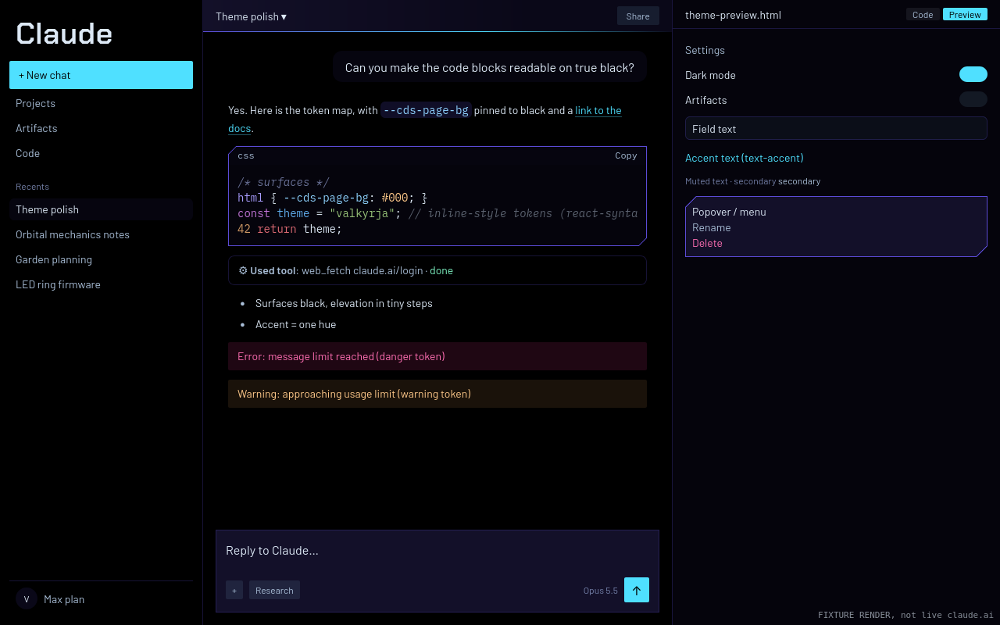

# Valkyrja Night for claude.ai (unofficial)

A true-black, neon restyle of [claude.ai](https://claude.ai) for Firefox. One stylesheet, no JavaScript, no data collected.

> **Unofficial.** Not affiliated with, sponsored or endorsed by Anthropic. "Claude" is a trademark of Anthropic, used here only to say which site this styles.


*Render of `fixture/index.html` (claude.ai's public stylesheet on a hand-built copy of the chat page) with the extension's CSS applied. Not a screenshot of a logged-in account.*

## What it does
- True-black backgrounds; depth from faint indigo layers, never grey.
- One cyan accent for buttons, links, focus and selection.
- Hot pink only where it carries meaning: errors and destructive actions.
- Readable code blocks; a single angular cut on secondary elements (code cards, dialogs, menus). Primary surfaces (the reply box, chat column, sidebar) stay plain.
- Barlow, Chakra Petch and IBM Plex Mono fonts, bundled (SIL Open Font License).
- claude.ai's light mode shows the dark theme too.

## Install
- **Firefox Add-ons:** link coming once the listing is approved.
- **From source (temporary):** `about:debugging` → This Firefox → Load Temporary Add-on → pick `ext/manifest.json`.

## Permissions and privacy
| | |
|---|---|
| Sites | `https://claude.ai/*` only |
| API permissions | none |
| Code | CSS only; zero JavaScript in the add-on |
| Network | none (fonts are bundled, no remote resources) |
| Data collection | none (`data_collection_permissions: none`) |

Comparison with Dark Reader's manifest: [docs/SECURITY-PROFILE.md](docs/SECURITY-PROFILE.md).

## Build and test
Node 20+.
```sh
npm install
npx playwright install firefox
npm test        # web-ext lint, build, package audit, fixture + live-login canaries
npm run build   # zip in dist/
```
- `tools/grab-css.mjs` fetches claude.ai's public stylesheet from the logged-out login page into `fixture/vendor/` (not committed: it's Anthropic's file).
- `canary/fixture-check.mjs` asserts computed colours on the fixture in claude.ai's dark and light modes.
- `canary/canary.mjs` loads the live login page logged out and checks every design token the theme overrides still exists there.

## How it works
claude.ai's design system exposes CSS custom properties (`--cds-*` tokens, role ramps, a grey ramp, older HSL variables). The stylesheet overrides those, not hashed class names, so most claude.ai updates don't break it. See [docs/DESIGN.md](docs/DESIGN.md).

## Contributing
Issues and pull requests welcome. Please include a before/after screenshot for any look change, keep the add-on CSS-only, and run `npm test`.

## Licence
Code: [MPL-2.0](LICENSE). Fonts: SIL OFL 1.1, see `ext/fonts/OFL-*.txt` and [NOTICE](NOTICE).
